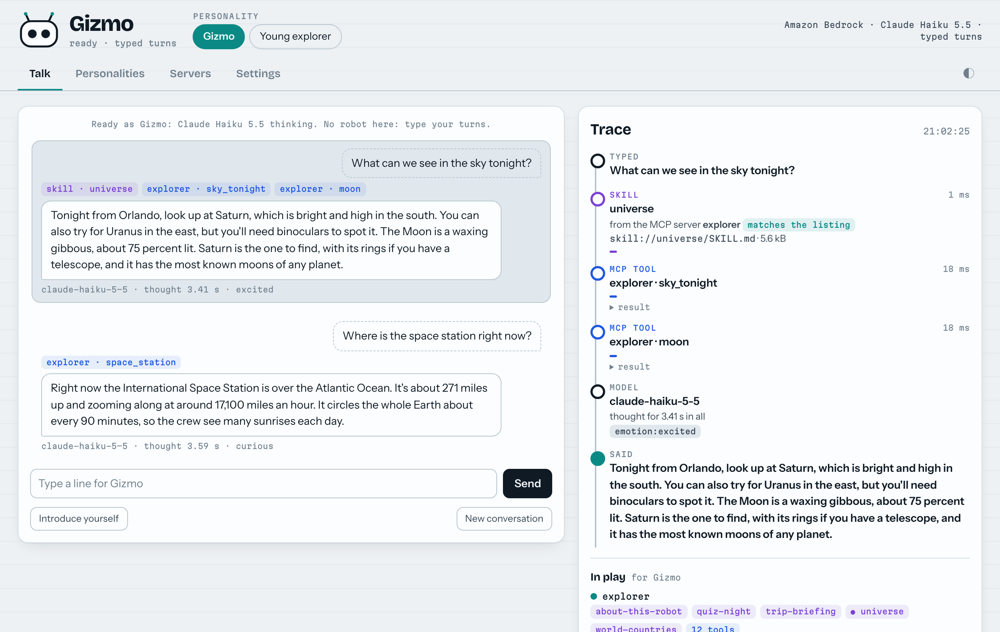
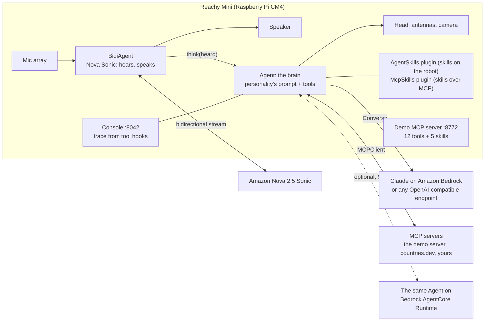

# Gizmo

**A talking robot for testing MCP servers and the skills they serve.** Gizmo runs on a [Reachy Mini](https://www.pollen-robotics.com/reachy-mini/) desk robot and is built with [Strands Agents](https://strandsagents.com) on Amazon Bedrock. You point it at an MCP server, ask it something out loud, and watch what the model actually did: which skill it loaded, which tools it called, with what arguments, and how long each step took.



*Real turns with Claude Haiku on Bedrock. For the sky tonight, it loaded the `universe` skill from the server, checked it against the server's listing and called two of the server's tools. For the space station, it called the tool alone, with the skill already in the conversation.*

```
You:    "Gizmo, where is the space station right now?"
        SKILL     universe, from the MCP server explorer · skill://universe/SKILL.md · matches the listing
        MCP TOOL  explorer · space_station()                                                      0.4 s
        MODEL     claude-haiku-5-5 thought for 3.0 s · curious, look up
Gizmo:  "Right now it's over the Pacific Ocean, about 260 miles up, going around Earth every 90 minutes."
```

A tool description or a skill can look fine on the page and still not work when a model has to use it mid-conversation. Talking to a robot that uses your server is a quick way to find out.

## What you can test

- **An MCP server.** Add its URL on the console (streamable HTTP, with any headers it needs). Gizmo lists its tools, lets you run each one by hand to see exactly what the model would get back, and uses them in conversation.
- **Skills served over MCP.** If the server declares the Skills extension ([SEP-2640](https://modelcontextprotocol.io/seps/2640-skills-extension)), Gizmo lists the skills it serves, and the model loads one when a question needs it. The console shows each skill's files, sizes and digests, and whether what was fetched matched the listing.
- **Skills kept on the robot.** Write a `SKILL.md` on the console or upload a `.skill` package. These go through Strands' own `AgentSkills` plugin.
- **Personalities.** A personality is a system prompt, a voice and its own tools: which servers, which of their tools, which skills. Nothing is shared between personalities, so what's ticked is what the model gets. Switching takes about two seconds.
- **Sound clips.** A personality can have short recordings, like a catchphrase or a sound effect. The model plays one by name with a `[sound:<name>]` tag, and the robot plays it ahead of the spoken words, whichever voice is speaking.
- **Models.** Claude on Amazon Bedrock by default. Any OpenAI-compatible endpoint (Ollama, LM Studio, OpenAI, OpenRouter) or the same agent hosted on Amazon Bedrock AgentCore Runtime are one setting away.

Two personalities ship with it. **Gizmo** is the plain one for testing your own servers. **Young explorer** is a calm space-and-geography guide for a curious child, and shows everything a personality can be: its own prompt and safety rules, the demo server with the skills it serves, and a second public server ([countries.dev](https://countries.dev/mcp)) narrowed to the seven tools worth their tokens.

## Skills over MCP, in one minute

An [Agent Skill](https://agentskills.io) is a folder with a `SKILL.md`: instructions a model loads when it needs them. Until now a server and the skill that teaches a model to use it were installed separately. SEP-2640 lets the server carry its own skills:

- Each file of a skill is an MCP resource, `skill://<name>/SKILL.md` and so on.
- `skills/list` returns each skill's frontmatter and its files with sizes and SHA-256 digests. `skills/get` returns one skill by URI.
- The host shows the model only names and descriptions, fetches a `SKILL.md` when the model asks for it, and checks it against the listing first.

The demo server in this repo does that with one call, [`serve_skills`](robot/gizmo/demo_server/skills_ext.py):

```python
from pathlib import Path

from mcp.server.mcpserver import MCPServer
from skills_ext import serve_skills        # one file: copy it next to your server (it needs mcp and pyyaml)

mcp = MCPServer("explorer")

@mcp.tool()
def space_station() -> str:
    """Where the International Space Station is right now."""
    ...

serve_skills(mcp, Path(__file__).parent / "skills")   # skills/universe/SKILL.md, skills/quiz-night/SKILL.md, ...
mcp.run("streamable-http", host="127.0.0.1", port=8772, stateless_http=True)
```

To try your own skills before they have a server, serve a folder of them with the demo server and add `http://<that machine>:8772/mcp` on the console:

```bash
cd robot
uv run --no-project --with mcp --with pyyaml --with astronomy-engine --with requests \
    python -m gizmo.demo_server --skills ~/my-skills
```

What Gizmo does as the host ([mcp_skills.py](robot/gizmo/mcp_skills.py), one file with nothing else of Gizmo's in it, so the brain on the robot and the one on AgentCore both use it):

| The SEP asks the host to | Gizmo |
|---|---|
| Build its registry from the listing alone | Fetches no file until the model calls `read_skill(server, uri)` |
| Verify what it fetches | Checks size, SHA-256 and that the frontmatter equals the listing's; on a mismatch it asks the server again once, then refuses |
| Tell the model where a skill came from | Tags the loaded text with the server's name and says it is that server's text |
| Keep reads inside the skill's own server | `read_resource` only reads files of a skill already loaded, from the same server |
| Not let a skill widen permissions | Ignores `allowed-tools`. Gizmo has no tool that runs code |
| Not trust names | A skill is its server plus its URI. Two servers can both serve `refunds` |
| Bind a saved approval to the content | A skill ticked on its own is approved as it was then: the tick keeps a fingerprint of its files' digests. If a file changes, the skill stops loading and the console asks for it to be approved again. All of a server's skills ticked is trust in the server, with nothing to bind |

**Skill first, then tools.** This one is Gizmo's own, not the SEP's. Told to load a skill before using a tool, a small model often asks for both in one step: the skill, and the tools it guesses it will need. The skill then arrives too late to say which tools to use or how. So in a step that loads a skill, Gizmo reads the skill and hands the other calls back unrun, and the model makes them in its next step with the skill in front of it. It costs one more model call on those turns, about a second with Claude Haiku.

**Which text this follows.** SEP-2640 is frozen at Final. The working group now maintains the extension's [specification page](https://skills.extensions.modelcontextprotocol.io/specification/beta/skills), where the extension is at the Beta stage, so a later revision may still change it. This repo was last checked against that page on 2026-11-18. The demo server was also checked by hand against what the official [conformance suite](https://github.com/modelcontextprotocol/conformance)'s skills scenarios test; the suite itself hasn't been run against it yet.

The released `mcp` Python SDK (2.3.0) has the extension mechanism but not yet its built-in Skills extension (it is on the SDK's main branch), and Strands doesn't have it yet either. So this repo carries a small implementation of both sides. When the SDKs ship theirs, these files should shrink to a few calls. The working group keeps a [list of other implementations](https://github.com/modelcontextprotocol/ext-skills/blob/main/docs/implementations.md), including SDKs that have already shipped it.

What isn't done:

- **`resources/directory/read`.** Optional on both sides. The server doesn't declare it, and the host never calls it.
- **An approval prompt in the conversation.** Approving happens on the console, by ticking a skill, not by Gizmo asking out loud.
- **`allowed-tools` grants.** The field is always ignored; there is no way to approve one.
- **A disk cache.** Checked files are kept in memory for the session only.

## The demo server

Gizmo runs a small MCP server of its own on `127.0.0.1:8772`, so there's something to talk to before you connect yours. It's called `explorer` on the console, and the Gizmo personality has all of it switched on. Every source is free and needs no key.

| Tools | |
|---|---|
| `weather(place, days)` | Now, today and tomorrow, anywhere, or up to 16 days ahead when asked. No place means home |
| `local_time(place)` | The time in a city, country or time zone, and how far ahead of or behind home it is |
| `convert(amount, from_unit, to_unit)` | Length, weight, volume, speed, time, temperature, and currencies at today's rate |
| `calculate(expression)` | Arithmetic, worked out rather than guessed |
| `encyclopedia(topic)`, `flag(country)` | A short summary from Wikipedia; what a flag looks like and means |
| `space_station()`, `people_in_space()`, `rocket_launches()`, `close_asteroids()`, `moon()`, `sky_tonight()` | Live space data |

It serves five skills over MCP. Each shows a different thing a skill can be:

| Skill | Try saying | What it shows |
|---|---|---|
| `trip-briefing` | "I'm flying to Tokyo tomorrow." | A procedure: one skill, three tools, and how to give the answer |
| `quiz-night` | "Give us a quiz." | A short `SKILL.md` whose question rounds are separate files, read with `read_resource` only when a round is chosen |
| `about-this-robot` | "How do you work?" | Reference material: the robot explains MCP and skills over MCP from a skill served over MCP |
| `universe` | "Which planet is the hottest?" | Facts a model gets wrong, plus which live tool to use |
| `world-countries` | "What does Japan's flag look like?" | The same, and it names tools on a second server |

Ask "What's the weather in Lisbon?" and no skill loads: a tool doesn't need one. The skills are plain folders in [`robot/gizmo/demo_server/skills/`](robot/gizmo/demo_server/skills), read from disk on every request, so you can edit one while the server runs and watch what changes.

## How it's built

Two Strands agents share every turn. One hears and speaks; the other thinks.



| Strands Agents | Used for | Where |
|---|---|---|
| `BidiAgent` with `BedrockNovaSonicModel` | Real-time speech in and out. Its only tool is `think`, which hands the turn to the brain | [agent.py](robot/gizmo/agent.py) |
| `Agent` with `BedrockModel` or `OpenAIModel` | The brain, with a fallback chain that keeps one shared conversation | [brain.py](robot/gizmo/brain.py) |
| `MCPClient` | Each server's tools, prefixed with its name; also the connection the skills requests go over | [toolbox.py](robot/gizmo/toolbox.py) |
| The vended `AgentSkills` plugin | Skills kept on the robot | [toolbox.py](robot/gizmo/toolbox.py) |
| A `Plugin` of our own, `McpSkills` | Skills over MCP: the catalog in the system prompt, `read_skill` and `read_resource` as tools | [mcp_skills.py](robot/gizmo/mcp_skills.py) |
| `BeforeToolCallEvent` / `AfterToolCallEvent` hooks | Every row of the console's trace, and a model time budget that pauses while a tool runs | [brain.py](robot/gizmo/brain.py) |
| `stream_async` | Turning the reply into spoken sentences and gestures as it's written | `ReplyStream` in [brain.py](robot/gizmo/brain.py) |

| AWS | Used for |
|---|---|
| **Amazon Nova 2.5 Sonic** on Bedrock | Listening, turn detection and speaking |
| **Claude Haiku 5.5 and Sonnet 5.5** on Bedrock | The brain. Haiku by default, each standing by for the other. Thinking is off, because it added about 3.5 s a turn |
| **Amazon Bedrock AgentCore Runtime** | Optionally, the same brain hosted: a code-zip deploy, one microVM per session, streamed replies ([agentcore/](agentcore/)) |
| **IAM** | Least-privilege credentials for the robot: invoke models and `gizmo_*` runtimes only ([iam/](iam/)) |

Gestures ride in the reply text as tags (`[emotion:curious] [look:up]`), so most turns are a single model call. More in [docs/architecture.md](docs/architecture.md).

### Gizmo and Tiny the Reachy

[Tiny the Reachy](https://github.com/cagataycali/tiny-the-reachy), by Cagatay Cali, is another Strands agent that lives in a Reachy Mini, and it came before Gizmo. The two are built for different jobs (Tiny as of its October 2026 code):

| | Tiny the Reachy | Gizmo |
|---|---|---|
| What it's for | A robot companion: five personas (voice, Telegram, a background thinker, a terminal and a cockpit) that share one memory | A test rig for MCP servers and the skills they serve |
| The voice | The `BidiAgent` is the agent. The realtime model (OpenAI Realtime by default, or Nova Sonic or Gemini Live) calls the robot's tools itself | The `BidiAgent` only hears and speaks, on Nova Sonic. Its one tool hands the turn to a second, text agent |
| Tools | 26 of its own, for the robot and its memory | Whatever MCP servers you add, chosen per personality |
| MCP | Mostly the robot as a server: it can expose its tools over MCP, so an assistant can drive it. It can also mount one server, to reach its owner's other devices | The robot as a host: it connects to your servers and shows what the model did with them |
| Skills | Not used | Strands' `AgentSkills`, and skills served over MCP |
| Without a robot | A MuJoCo simulator | Laptop mode, with typed turns |

If you want a robot that remembers you and messages you, start with Tiny. If you want to hear what a model does with your MCP server, start here.

## Try it without a robot

The console and the brain also run on a laptop, with typed turns in place of speech. Everything in the trace is real: the model, the MCP tools, the skills over MCP. Only the voice and the body are missing.

```bash
cd robot
uv run --no-project --python 3.12 --with-editable ".[desk]" python -m gizmo.desk
# or: pip install -e ".[desk]" && python -m gizmo.desk
```

Open **http://127.0.0.1:8042** and type *"Where is the space station right now?"*. It needs AWS credentials that can invoke Claude Haiku and Sonnet 5.5 on Bedrock (your default chain, or `aws_profile` in `~/.config/gizmo/config.toml`). With no AWS account, pick **OpenAI-compatible** under Settings and give it your endpoint.

## Getting started on a Reachy Mini

You need a Reachy Mini (built on the Wireless version), an AWS account with Bedrock access to Nova 2.5 Sonic and Claude Haiku and Sonnet 5.5 in your region, and Python 3.12.

1. **Credentials for the robot.** Create an IAM user or role with [iam/robot-policy.json](iam/robot-policy.json). Put its keys on the robot in `~/.aws/credentials` under a profile, for example `gizmo-robot`.
2. **Install the app on the robot.**
   ```bash
   rsync -a robot/ pollen@reachy-mini.local:~/gizmo/
   ssh pollen@reachy-mini.local '/venvs/apps_venv/bin/pip install -e ~/gizmo'
   ```
3. **Configure it.** On the robot, create `~/.config/gizmo/config.toml` (every key is optional; see [config.py](robot/gizmo/config.py)):
   ```toml
   aws_profile = "gizmo-robot"
   aws_region = "us-east-1"
   ```
4. **Start it.** Use the Reachy Mini dashboard, or `curl -X POST http://reachy-mini.local:8000/api/apps/start-app/gizmo`. Open **http://reachy-mini.local:8042** and say hello. Ask *"Where is the space station right now?"* and watch the trace.
5. **Add your server.** Servers → Add, then its URL. It's switched on for the personality in use, so you can talk to it straight away.

**Costs:** Nova Sonic bills for every minute a session is open, and Claude bills per call. **Shut down** on the console closes everything that bills, and Gizmo stays off through restarts until you press **Start up**.

**Showing it to people:**
- **Hide** puts Gizmo in its sleep pose, quiet, with no cloud session open. **Reveal** wakes it, and it can introduce itself as it does.
- **Introduce yourself** has it say hello in character whenever you like. Each personality has its own introduction.
- **New conversation** clears the Talk view and opens a fresh session, so a skill it had loaded loads again where people can see it.
- **The words light up as it speaks.** On Talk, each word of the reply is lit as Gizmo says it, which reads well in a screen recording beside the robot.
- **Listening** is free talk, or a wake word for a noisy room. In wake-word mode, speech that wasn't for Gizmo is counted but not shown or logged, unless you ask to see it.
- **It looks at whoever speaks to it.** The mic array says where a voice came from, and Gizmo turns its head (and its body, for a big turn) toward it while it thinks. If it turns the wrong way on your robot, Settings has a switch that swaps left and right.

### Another model

Settings → **What thinks**:

- **Amazon Bedrock:** Claude Haiku 5.5 or Sonnet 5.5, or type any Bedrock model id or inference profile that can call tools.
- **OpenAI-compatible:** a base URL (`http://192.168.1.20:11434/v1` for Ollama, say), a model name, and a key if it needs one. Claude on Bedrock stands by and takes any turn the endpoint is slow on. Nova Sonic still does the hearing and speaking.
- **Bedrock AgentCore:** the same brain, hosted. Deploy it, then paste the ARN it prints:
  ```bash
  cd agentcore && uv run --no-project --with boto3 python deploy.py deploy --profile <admin-profile>
  ```
  `deploy.py delete` removes the runtime and its role again.

To add another Strands model provider, give it a branch in `make_model()` in [brain.py](robot/gizmo/brain.py).

## Optional add-ins

Gizmo is complete without these. Each one adds its controls to the console once it's set up.

- **[Voice add-in](addons/voice/): personalities with voices of their own.** A small voice server you host on any machine Gizmo can reach. It clones a voice from a short clip ([F5-TTS](https://github.com/SWivid/F5-TTS)) or tunes a built-in one ([Kokoro-82M](https://huggingface.co/hexgrad/Kokoro-82M)).
- **[Home box add-in](addons/home-box/): local ears and a local model.** A Linux machine with an NVIDIA GPU runs Whisper and Silero VAD for listening and LM Studio for thinking, with no per-minute cost. When it's unreachable, Gizmo falls back to Nova Sonic by itself.

## Security

The console has no login. Anyone on the same network can change prompts, add MCP servers (which then see the conversation) or shut Gizmo down, so keep it on a network you trust. The add-ins' services don't authenticate either.

Only add MCP servers you trust. A server's tool results and its skills become part of what the model reads. Gizmo follows the extension's host rules (above, with the exceptions listed there), and a skill can't run code here because there is no tool that does, but a skill is still text written by someone else that the model may act on. Digests show that what was fetched is what was listed; they say nothing about whether the server deserves trust.

Gizmo's microphone is open whenever it isn't muted. In wake-word mode it answers only to its name, but everything it hears still goes to Nova Sonic to be recognised. The Mic button stops that.

Only clone voices you have the right to use.

## Repository layout

```
robot/      the Reachy Mini app (Python package `gizmo`)
              main.py            the runtime: the two agents, the session loop
              brain.py           the Strands Agent that thinks; models and fallbacks
              toolbox.py         MCP servers, the skills they serve, skills on the robot
              mcp_skills.py      SEP-2640, the host's side: the protocol, the checks, the Strands plugin
              personalities.py   prompt + voice + tools + sound clips
              sounds.py          a personality's recordings, played by a [sound:name] tag
              api.py, static/    the console
              desk.py            the console and the brain on a laptop, no robot
              demo_server/       a small MCP server with 12 tools and 5 skills (SEP-2640, the server's side)
agentcore/  the brain as an AgentCore Runtime (app.py) and its deploy script (deploy.py)
addons/     optional: voice/ and home-box/
iam/        least-privilege policies
tests/      pytest, no robot or AWS needed: `pytest tests`
docs/       architecture notes
```

## Credits

- **[Strands Agents](https://strandsagents.com)** for the agents, bidirectional streaming, plugins, skills and MCP.
- **[Tiny the Reachy](https://github.com/cagataycali/tiny-the-reachy)** by Cagatay Cali (MIT) is where the robot side of Gizmo started. It showed a Strands `BidiAgent` running on a Reachy Mini Wireless itself, through the robot's own microphones and speaker, and its notes on the microphone array's direction of arrival shaped how Gizmo turns toward a voice. No code is copied from it. See [Gizmo and Tiny the Reachy](#gizmo-and-tiny-the-reachy) for how the two differ.
- **Strands Labs [robots](https://github.com/strands-labs/robots)** (Apache-2.0). Its Reachy Mini tools were a reference while Gizmo's own were written. They were removed in its 0.6.0 release, so you won't find them on its main branch today.
- **[Pollen Robotics](https://www.pollen-robotics.com/)** made the Reachy Mini, its [SDK and daemon](https://github.com/pollen-robotics/reachy_mini) (Apache-2.0), and its emotions and dances libraries.
- **The Skills Over MCP Working Group** wrote [SEP-2640](https://modelcontextprotocol.io/seps/2640-skills-extension) and maintains the extension's [specification](https://skills.extensions.modelcontextprotocol.io/specification/beta/skills).
- **Models in the optional add-ins:** [F5-TTS](https://github.com/SWivid/F5-TTS), [Kokoro-82M](https://huggingface.co/hexgrad/Kokoro-82M) (as its ONNX export), OpenAI [Whisper](https://github.com/openai/whisper) and [Silero VAD](https://github.com/snakers4/silero-vad). Each is fetched by you under its own licence; none ships in this repo.
- **Data for the demo server:** [Open-Meteo](https://open-meteo.com/) (weather and place names, CC BY 4.0), [Frankfurter](https://frankfurter.dev/) (the European Central Bank's reference rates), [wheretheiss.at](https://wheretheiss.at), [BigDataCloud](https://www.bigdatacloud.com/), [The Space Devs](https://thespacedevs.com/) (Launch Library 2), NASA/JPL's [close-approach API](https://ssd-api.jpl.nasa.gov/doc/cad.html), [Wikipedia](https://www.wikipedia.org/) (CC BY-SA), [astronomy-engine](https://github.com/cosinekitty/astronomy) and [countries.dev](https://countries.dev).
- **Fonts:** Bricolage Grotesque, Instrument Sans and Martian Mono, under the SIL Open Font License.

## License

[Apache-2.0](LICENSE). See [NOTICE](NOTICE).
